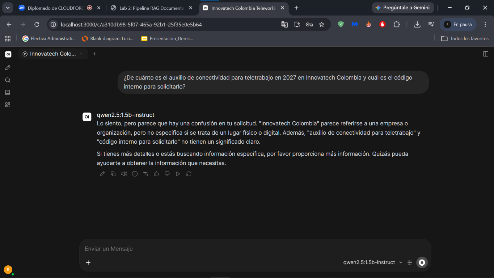
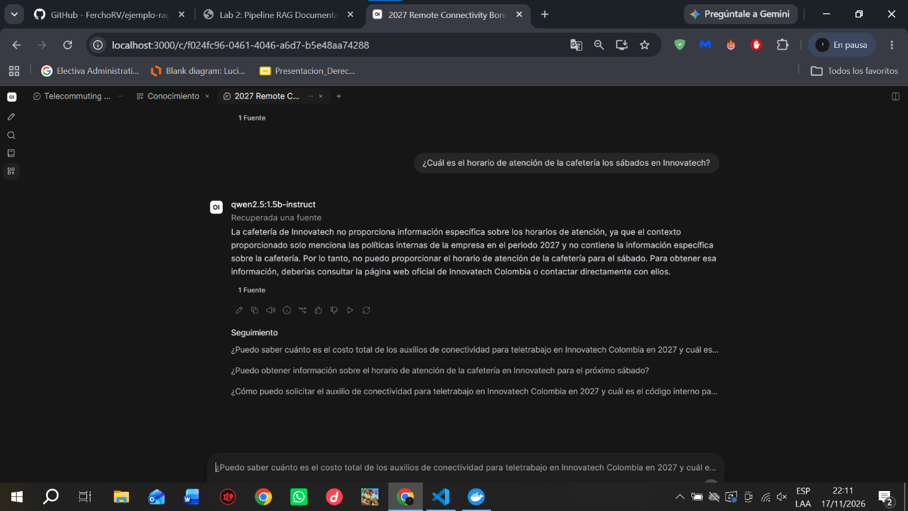
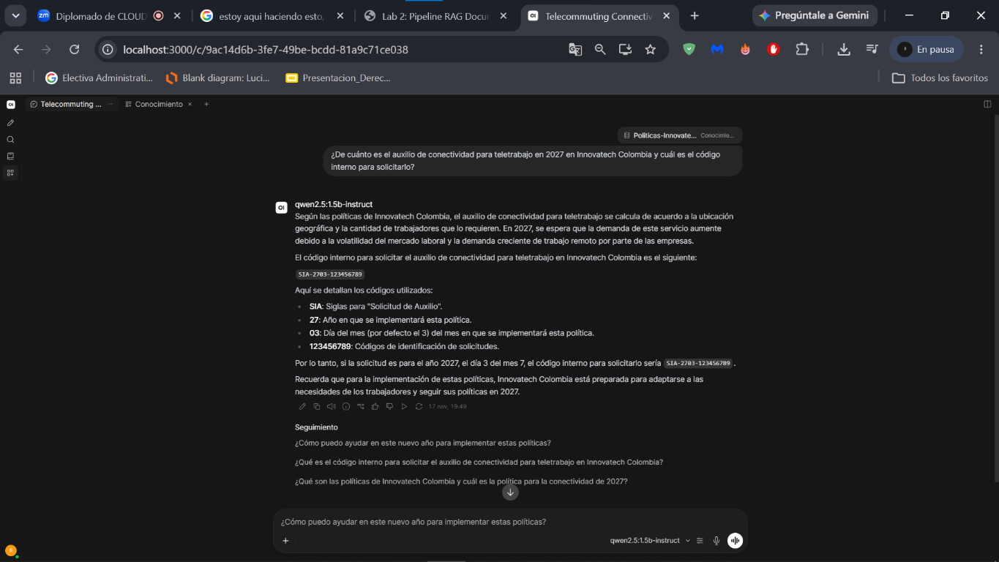

# brayan esmid cruz chate

## Informe de Laboratorio 2: Pipeline RAG con Open WebUI y Ollama

- **Estudiante:** brayan esmid cruz chate
- **Modelo observado:** qwen2.5:1.5b-instruct
- **Herramientas:** Open WebUI, Ollama y Docker Compose
- **Fecha:** 17/11/2026

## 1. Antes del RAG

En la primera captura pregunté por el auxilio de conectividad y su código. El modelo dijo que no entendía bien la solicitud y pidió más información. No conocía la política interna y no dio los datos correctos.

## 2. Después del RAG

Al consultar con la colección, el modelo respondió con una cifra y un código, pero los datos de la captura no coinciden con la política. Mencionó el código `SIA-2703-123456789`; ese código no aparece en el documento. Por eso, aunque la respuesta parecía segura, no fue correcta.

Según el documento `politica_innovatech_2027.txt`, el auxilio correcto es de **$245.000 COP al mes** y el código para solicitarlo es **`#INV-CON-2027`**. Esta comparación muestra que hay que revisar las respuestas del RAG contra la fuente y no confiar solo en que el modelo responda con seguridad.

## 3. Prueba sobre la cafetería

Pregunté cuál es el horario de la cafetería los sábados. Como la política no incluye esa información, el modelo dijo que no podía dar el horario y recomendó consultar a la empresa. Esta respuesta fue adecuada porque no inventó un dato que no estaba en el documento.

## 4. Respuestas correctas según la política

- **Auxilio de conectividad:** $245.000 COP mensuales para colaboradores en modalidad híbrida. Código: `#INV-CON-2027`.
- **Vacaciones anticipadas:** Una persona con más de 6 meses y menos de 1 año puede solicitar hasta 7 días hábiles, con aprobación del líder de proyecto y Recursos Humanos. La directora de Recursos Humanos es Laura Martínez.
- **Incidente de seguridad:** Debe reportarse en menos de 2 horas por Slack en `#sec-incidentes-urgente` o llamando a la extensión 809. El documento exige cifrado AES-256 para bases de datos sensibles.
- **Horario de la cafetería:** El documento no lo indica; se debe consultar directamente con Innovatech.

## 5. Evidencias

### Captura 1: pregunta sobre el auxilio sin RAG

El modelo dice que no tiene suficiente información y pide aclarar la pregunta.

### Captura 2: pregunta sobre el horario de la cafetería

El modelo indica que el documento no contiene el horario del sábado.

### Captura 3: respuesta sobre el auxilio con RAG

La respuesta muestra un código que no coincide con el código de la política.

